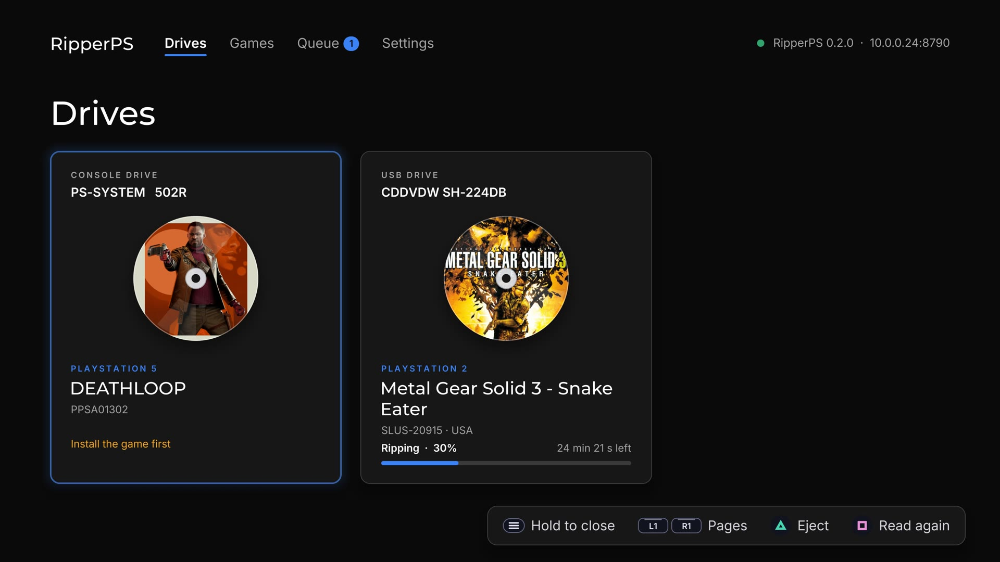

# ripper



A PS5 app that lets you rip your movie/music/game discs into the well known formats. My PS5 already had a perfectly good Blu-ray drive just sitting there, so I figured why not make it rip everything I own. It reads through the console's own drive and any USB drive you plug in, and sends the rips to the console, a USB disk, your NAS or your RomM server.

- **Rip from any drive**
  - Use the PS5's own Blu-ray drive, or plug in any USB CD, DVD or Blu-ray drive. Use both at the same time if you want.
- **Formats you actually use**
  - CHD, BIN/CUE and ISO for games, MKV and MP4 for movies, and FLAC, MP3 and friends for music, tagged and with cover art.
- **Decrypts on the fly**
  - DVD movies come out decrypted, and so do PS3 discs if you have the keys.
- **Sends rips wherever you keep them**
  - Keep them on the console or a USB disk, or send them to SMB, NFS, FTP or straight into RomM. If you already use RommPS, ripper can pick up your RomM server from it.
- **PS4 and PS5 games**
  - Dumps your installed games, whether they came from a disc or not.
- **RipperPS and a Web UI**
  - Rip from the couch with the native app, or from your phone or PC on the same network.
- **Frequently updated, AI-free, and thoroughly tested.**

## Help us test: send a drive report

RipperPS supports far more discs than I've been able to test. Not only this, but the drive you use dictates what we can rip. The built-in drive, a stock USB DVD writer and an LG Blu-ray drive with LibreDrive, OmniDrive or Kreon firmware all behave differently. We know most formats work, but there are some we need custom firmware drives like (Xbox, Xbox 360, Dreamcast, etc) which I don't have.

That's where you come in. I have created a drive/disc test inside the app that you can run for me. It reads your type of drive, and any discs you enter. Look below to see which we need more samples of. Once done, it generates a test file, and you send it in a GitHub issue to us. This will be an immense help, and I appreciate every test.

1. Open **Drive test** (it's a tab in the web UI, and in Settings in RipperPS) and hit **Start** next to your drive.
2. Pop your discs in one at a time. It'll tell you when to swap, and you tell it what each disc is.
3. Hit **Finish**, download the zip and attach it to the [drive report form](https://github.com/s0liton/RipperPS/issues/new?template=drive-report.yml).

Most wanted:

| Disc | Drive |
|---|---|
| GameCube, Wii | OmniDrive |
| Xbox, Xbox 360 | Kreon or OmniDrive |
| Wii U | OmniDrive Blu-ray drive |
| Dreamcast | a CD drive that reads GD-ROMs |
| Saturn, Sega CD, PC Engine CD, 3DO, CD-i | any CD drive |
| PS4, PS5, Xbox One / Series | any USB Blu-ray drive |
| Blu-ray movies | any Blu-ray drive |

The full walkthrough is in the [tester guide](docs/drive-test.md).

Note: Your privacy is fully preserved. No unique IDs about your console, drives, or games are collected in this test.

## What it rips

| Disc | Drive | Output | Tested on hardware |
|---|---|---|---|
| PS2 DVD | built-in or USB DVD | ISO, CHD | yes |
| PS3 Blu-ray / DVD | built-in | ISO (whole or split for FAT32) or game folder, decrypted with a key file | partly |
| PS4 / PS5 | built-in | game dump (folder, `.ffpkg` or `.exfat`) | yes, once the game is installed |
| DVD-Video | built-in or USB DVD | MKV, MP4, ISO | yes |
| Blu-ray Video | built-in or USB Blu-ray | ISO, decrypted with a KEYDB.cfg | not yet |
| DVD / Blu-ray data, PC discs | built-in or USB | ISO, CHD | not yet |
| Audio CD | USB | FLAC, MP3, AAC, ALAC, Opus, WAV, BIN/CUE | yes, FLAC and MP3 |
| PS1 | USB | CHD, BIN/CUE | yes |
| PS2 CD | USB | ISO, CHD, BIN/CUE | yes, CHD and BIN/CUE |
| Saturn, Sega CD, PC Engine CD, PC-FX, Neo Geo CD, 3DO, CD-i, Video CD | USB | CHD, BIN/CUE | not yet |
| Dreamcast | USB drive that reads GD-ROMs | GDI | not yet |
| Xbox | USB with Kreon or OmniDrive | XISO, ISO | not yet |
| Xbox 360 | USB with Kreon or OmniDrive | ISO | not yet |
| GameCube | USB with OmniDrive | ISO, CISO, RVZ | not yet |
| Wii | USB with OmniDrive | WBFS (whole or split for FAT32), ISO, RVZ | not yet |
| Wii U | USB with OmniDrive | WUD | not yet |
| Xbox One / Series | USB Blu-ray | ISO (still encrypted) | not yet |

"Not yet" means I haven't been able to try it on a real disc. That's where your [drive reports](#help-us-test-send-a-drive-report) come in.

##Experimental Notice

This app is considered experimental and may have any number of problems. While it has worked really well in my personal day to day testing, I will need to refine the app more before I can say comfortably that you can let it watch your kids. Please help by reporting any bugs, and PLEASE submit drive tests as detailed above to help me confirm and support all the possible DVD players. 
  
  
I plan for the app to be out of experimental state by end of this year.
## Requirements

- A jailbroken PS5 with an ELF loader (etaHEN or similar)
- A USB drive for CDs (music, PS1 and other CD games), since the PS5's drive can't read them
- For PS3 discs, a key file, and for Blu-ray movies a KEYDB.cfg (neither included, don't ask)

## Install

ripper will be on ProsperoStore once it's out of pre-release. Until then, it's a manual install.

### Manual Install

Download `PPSA76700.zip` from the [releases page](https://github.com/s0liton/RipperPS/releases), unzip it and copy the `PPSA76700` folder to `/data/homebrew/` on the console. Add it with your launcher (ShadowMountPlus or similar) and launch RipperPS. It'll start the background service for you.

If you'd rather run just the payload, without the app:
1. Download the latest `ripper.elf` from the releases page.
2. Send it to the console (or use whichever favorite tool you wish):
   ```sh
   nc -w 1 <ps5-ip> 9021 < ripper.elf
   ```
3. Open `http://<ps5-ip>:8790` from another device.

### How it runs

All the ripping is done by a background payload, so you can close RipperPS and keep **gaming** (or watch whatever you just ripped). It keeps the console awake while it rips, so rest mode won't cut a rip short. It doesn't autostart yet, so after a reboot just open RipperPS again, or resend `ripper.elf`.

## Updates

Copy the new release's folder over the old one. RipperPS swaps in its new payload the next time you open it, once nothing is ripping. An older version never replaces a newer one. If you only run the payload, just send the new `ripper.elf`.

## Setup

Everything lives in Settings, in RipperPS or the web UI.

- **Destinations:** where your rips go. "Local Location" is there out of the box. Add a USB drive, SMB, NFS, FTP or RomM (sign in with the code it shows you). Folders are picked from a list, no typing paths.
- **Default Rip Settings:** what each kind of disc rips to unless you change it. PS1 to CHD on RomM, music CDs to FLAC on your NAS, whatever you like.
- **PS3 key file:** `/data/ripper/keys/ps3.keys` by default. To use a file somewhere else, pick it in Settings, under Keys.
- **Blu-ray keys:** a `KEYDB.cfg` (the file libaacs reads), `/data/ripper/keys/KEYDB.cfg` by default. Without the disc's key, the ISO stays encrypted.
- **Movie names and posters:** Wikipedia, best effort, no key needed. For the best matches, add a free TMDB key (themoviedb.org).

## Ripping

Pop a disc in. ripper figures out what it is and fills in the format and destination from your settings. Change whatever you want for that disc and hit **Rip**. You can follow it in the Queue, and the disc pops out when it's done.

PS4 and PS5 discs need to be installed first, then you can dump them. The **Games** tab dumps any installed game.

## Web UI

ripper exposes a Web UI at `http://<ps5-ip>:8790` where you can do everything the app does, plus read the log.

## Problems

- **The web UI won't open:** if the console was in rest mode when you sent the payload, it never got there. Wake it up and send `ripper.elf` again.
- **"Can't be ripped here":** check [What it rips](#what-it-rips). A lot of discs need a USB drive.
- **Anything else:** on the Log tab, hit **Download reports** and attach the zip to an [issue](https://github.com/s0liton/RipperPS/issues/new). I'll take a look.

## Building

```sh
cmake -S . -B build/host -G Ninja && cmake --build build/host   # host build: tests, ripper-cli, ripperd
(cd build/host && ctest --output-on-failure)                     # tests
tools/ps5-build.sh                                               # PS5 payload in Docker, build/ps5/ripper.elf
```

How the code fits together, building RipperPS and everything else for devs is in [docs/development.md](docs/development.md).

## Watch Development Progress

I've started streaming the development of this app as well as other side projects on my YouTube channel. Nothing serious, but you can catch me live streaming. ;)

[My Channel](https://www.youtube.com/@soliton_radar)

## P.S to the industry

If buying isn't **owning**, then piracy **isn't** stealing. 🖕

## Shameless Plug

<a href='https://ko-fi.com/M7G128GENT' target='_blank'></a>

## License

GPL-3.0. [libdvdcss](https://www.videolan.org/developers/libdvdcss.html) is GPL-2.0-or-later. [cJSON](https://github.com/DaveGamble/cJSON) and [QR Code generator](https://www.nayuki.io/page/qr-code-generator-library) are MIT. idlesauce's [ps5-self-pager](https://github.com/idlesauce/ps5-self-pager) is Unlicense. PS5 game dumps carry drakmor's [pgo_stub](https://github.com/drakmor/pgo_stub) and [ampr_emu](https://github.com/drakmor/ampr_emu) (GPL-3.0). The game name database comes from [Redump](http://redump.org) (CC-BY-SA-4.0). Drive access follows [ps-disc-detect](https://github.com/Al-Azif/ps-disc-detect), and the custom firmware reads follow [redumper](https://github.com/superg/redumper). RipperPS is built on mihawk-99's [PS5 Vulkan Template](https://github.com/mihawk-99/PS5_VulkanTemplate) and BlackBearReloaded's UI kit; its licenses are in [its README](platform/ps5/app/ripper/README.md).
